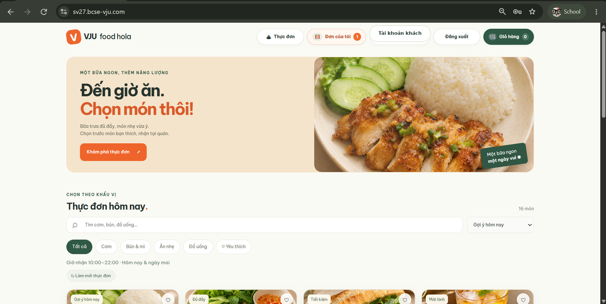

# VNU Food Hola

[](https://github.com/s2005on/vnu-food-hola/actions/workflows/backend-ci.yml)

**Website đặt món thử nghiệm dành cho sinh viên Trường Đại học Việt Nhật (VJU).**

[Demo SV27](https://sv27.bcse-vju.com/) · [Báo cáo tổng kết và bàn giao](docs/FINAL-HANDOVER.md) · [Kết quả kiểm chứng](VERIFICATION.md)

> Dự án học phần CSE3045, dùng thực đơn và dữ liệu mẫu cho một quán. Máy chủ SV27 được kiểm tra ngày 15/11/2026; liên kết phụ thuộc thời hạn cấp VPS và gateway của trường, không cam kết hoạt động liên tục.

## Chức năng

- **Khách:** xem 16 món, tìm kiếm, lọc, thêm giỏ, đặt món và chọn địa điểm/giờ nhận.
- **Tài khoản khách:** đăng ký bằng họ tên, số điện thoại và mật khẩu; đăng nhập, xem lịch sử đơn.
- **Theo dõi đơn:** tra cứu bằng mã đơn và mã bí mật; có thể liên kết đơn cũ vào tài khoản.
- **Quản trị:** quản lý thực đơn, xác nhận/chuẩn bị/sẵn sàng/hoàn thành hoặc hủy đơn; ghi nhận thanh toán tiền mặt riêng với trạng thái xử lý.
- **Kiểm soát nghiệp vụ:** máy chủ tự tính giá, kiểm tra dữ liệu và hạn chế tạo đơn trùng; dữ liệu demo được tách khỏi dữ liệu quán.

## Công nghệ

| Thành phần | Công nghệ |
|---|---|
| Backend | Python, FastAPI |
| Database | SQLite |
| Frontend | HTML, CSS, JavaScript |
| Web server | Uvicorn, Nginx |
| Kiểm thử | unittest, Node.js test runner, GitHub Actions |

## Giao diện và minh chứng



Bộ ảnh đã che thông tin khách hàng: [Minh chứng triển khai và luồng đơn ngày 15/11/2026](docs/evidence/sv27-2026-11-15/README.md).

## Chạy trên Windows

1. Cài Python 3.11 hoặc 3.12.
2. Clone hoặc tải toàn bộ repository.
3. Chạy `RUN-WINDOWS.bat`.
4. Ở lần đầu, tạo mật khẩu quản trị khi chương trình yêu cầu.

| Giao diện | URL cục bộ |
|---|---|
| Khách hàng | http://127.0.0.1:8016/ |
| Quản trị | http://127.0.0.1:8016/admin.html |

Giữ cửa sổ máy chủ mở trong khi sử dụng. Xem [hướng dẫn chạy và demo](START-HERE.md); trước khi nâng cấp bản cũ, đọc [ghi chú giữ dữ liệu](START-V7.3.md).

## Kiểm thử

Cài dependencies:

```bash
python -m pip install -r server/requirements-test.txt
```

Chạy kiểm thử backend và frontend:

```bash
python -m unittest discover -s tests -p test_server.py -v
node --test tests/customer-refresh.test.cjs tests/cart-drawer.test.cjs tests/menu-cards.test.cjs tests/customer-accounts.test.cjs
```

Cần cài Node.js để chạy kiểm thử JavaScript. CI chạy trên Ubuntu/Python 3.12 và Windows/Python 3.14.

## Cấu trúc repository

| Đường dẫn | Nội dung |
|---|---|
| `server/` | FastAPI, giao diện hiện hành, dữ liệu mẫu |
| `tests/` | Kiểm thử backend và JavaScript |
| `deploy/` | Cấu hình và hướng dẫn VPS/Nginx |
| `docs/` | Yêu cầu, thiết kế, hồ sơ học phần và minh chứng |
| `demo/` | Bản giao diện tĩnh lịch sử |
| `RUN-WINDOWS.bat` | Khởi chạy ứng dụng trên Windows |

## Trạng thái và giới hạn

- MVP và tài khoản khách đã tích hợp qua [PR #10](https://github.com/s2005on/vnu-food-hola/pull/10) và [PR #14](https://github.com/s2005on/vnu-food-hola/pull/14).
- Bản triển khai SV27 được kiểm tra theo commit `0eba90e` ngày 15/11/2026.
- Tag `v0.1.0` là mốc demo tĩnh; **`v0.2.0` chưa phát hành**.
- Chưa có thanh toán trực tuyến, OTP/SMS, khôi phục mật khẩu tự động, giao hàng qua shipper hoặc hỗ trợ nhiều quán.
- Chưa xác minh vận hành 24/7, khôi phục backup, kiểm thử thủ công trên thiết bị thứ hai hoặc nghiệm thu cuối cùng của giảng viên.

## Tài liệu

- [Báo cáo tổng kết và bàn giao](docs/FINAL-HANDOVER.md)
- [Mục lục tài liệu](docs/README.md)
- [Project Charter](docs/01-project-charter.md) · [Yêu cầu hệ thống](docs/02-requirements.md) · [Thiết kế hệ thống](docs/03-system-design.md)
- [Hồ sơ giữa kỳ](docs/MIDTERM.md) · [Kết quả kiểm chứng](VERIFICATION.md)
- [Changelog](CHANGELOG.md) · [Quy ước Git](docs/GIT.md) · [Quy ước phiên bản](docs/VERSIONING.md)
- [Hướng dẫn triển khai VPS](deploy/README.md) · [Kế hoạch phát hành v0.2.0](docs/RELEASE-v0.2.0.md)

**Minh bạch công cụ:** một số công cụ AI được dùng để hỗ trợ phát triển và biên soạn tài liệu; người thực hiện chịu trách nhiệm kiểm thử và giải thích mã nguồn.
