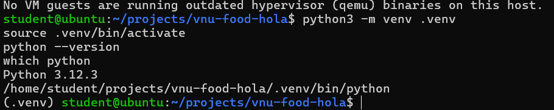
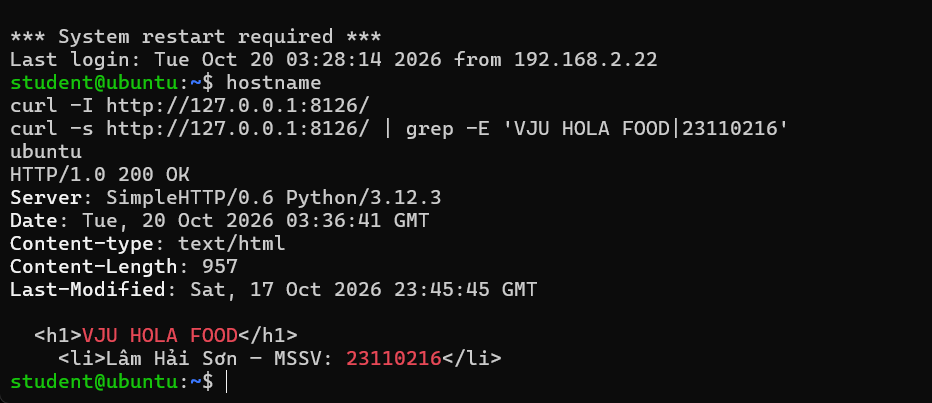

# Bản cập nhật V7.3

Đọc [START-V7.3.md](START-V7.3.md) trước khi chạy hoặc nâng cấp để giữ dữ liệu cũ. Bản này gộp luồng Guest và UI V7.2, có 16 món và mật khẩu quản trị từ 6 ký tự.

> **V5 mới nhất:** xem [V5-REVIEW.md](V5-REVIEW.md). Hướng dẫn V4 bên dưới là lịch sử; V5 tách quyền khách/quán, nhập địa điểm và dùng giờ 10:00–22:00.

> **Bản nâng cấp V4:** xem [V4-REVIEW.md](V4-REVIEW.md) về đăng nhập thử, kiểm thử và cập nhật VPS.

# VJU Food Hola

Website đặt đồ ăn cho sinh viên VJU — Lâm Hải Sơn, MSSV 23110216.
Bản V3 dùng FastAPI + SQLite; giữ giao diện V2. Một quán, thanh toán khi nhận,
không tích hợp AI. Đây là bản chạy thử với thực đơn mẫu.

## Chạy trên Windows

Cài Python và Git. Trong thư mục repo, chạy `RUN-WINDOWS.bat`.
Lần đầu tạo tài khoản quản trị `son`, mật khẩu 12–128 ký tự.
Giữ cửa sổ chạy mở; không mở trực tiếp HTML bằng file://.

- Khách: http://127.0.0.1:8016/
- Quản trị: http://127.0.0.1:8016/admin.html
- Chi tiết: [START-HERE.md](START-HERE.md).

## Mã nguồn và dữ liệu

- `server/`: backend và giao diện đang dùng; `demo/`: bản mẫu lịch sử.
- `tests/`: kiểm thử API và logic cập nhật đơn phía khách.
- `deploy/`: cấu hình mẫu VPS; phải đối chiếu máy/cổng/đường dẫn trước khi dùng.
- `server/data/`: SQLite cục bộ, không đưa lên Git. Không xóa khi cập nhật mã.
- `docs/03-system-design.md`: mô tả đúng thiết kế V3 hiện tại.

## Kiểm thử

```sh
python -m pip install -r server/requirements-test.txt
python -m unittest discover -s tests -p test_server.py -v
node --test tests/customer-refresh.test.cjs
node --check server/web/app.js
node --check server/web/admin.js
```

CI được cấu hình cho Ubuntu/Python 3.12 và Windows/Python 3.14.
Xem [VERIFICATION.md](VERIFICATION.md) để phân biệt kết quả đã chạy và phần chưa xác minh.

## Git và triển khai

Quy trình mục tiêu: feature/fix → develop → main sau khi kiểm thử đạt.
Hiện PR #9 chứa V3 và đang nhắm vào main; các PR cũ còn mở.
Cần review quan hệ phụ thuộc và thống nhất nhánh tích hợp trước khi merge;
việc tạo bản sửa này không tự merge hay đóng các PR khác.

Hướng dẫn VPS và sao lưu: [deploy/README.md](deploy/README.md).
Chưa xác nhận V3 chạy trên VPS. CI kiểm thử không đồng nghĩa CD tự triển khai.

## Hồ sơ thực hành trước V3

### Hồ sơ B2

Website đặt đồ ăn cho sinh viên VNU

## Người thực hiện


- Lâm Hải Sơn — MSSV: 23110216.

- Hiện tại dự án có một người thực hiện, phụ trách tài liệu,

  giao diện, backend, kiểm thử và triển khai.


## Quy trình Git của dự án


- main: phiên bản ổn định.

- develop: nhánh tích hợp các thay đổi.

- feature/*: nhánh thực hiện từng công việc.

- Quy trình: tạo nhánh từ develop → sửa và kiểm tra →

  commit → push → mở Pull Request vào develop → review → merge.

- Mỗi PR trình bày: thay đổi gì, vì sao, cách kiểm tra

  và phần có AI hỗ trợ.

- Do hiện chỉ có một thành viên, việc review chéo cần được

  giảng viên hướng dẫn cách thay thế. Tự kiểm tra và AI hỗ trợ

  không được ghi nhận thành review của thành viên khác.


## Pre-mortem: Vì sao đồ án có thể thất bại?


Giả định cuối kỳ sản phẩm không đạt yêu cầu, các nguyên nhân

có thể xảy ra và cách phòng ngừa gồm:


| STT | Nguy cơ thất bại | Nhóm nguyên nhân CHAOS | Hành động phòng ngừa |
|---|---|---|---|
| 1 | Chưa hiểu sinh viên cần gì khi đặt đồ ăn | Yêu cầu | Hỏi thử sinh viên mục tiêu, ghi lại nhu cầu và tiêu chí chấp nhận trước khi làm tính năng. |
| 2 | Liên tục thêm thanh toán, giao hàng, khuyến mãi khiến phạm vi quá lớn | Yêu cầu | Chốt phạm vi MVP; đưa ý tưởng mới vào danh sách chờ và chỉ thêm khi việc cốt lõi đã chạy. |
| 3 | Làm xong mới cho người dùng xem, phát hiện luồng đặt món khó dùng | Con người/bên liên quan | Cho người dùng thử từng luồng nhỏ và ghi nhận phản hồi sớm. |
| 4 | Một người phải làm mọi phần, bị quá tải khi trùng lịch học | Quản lý/nguồn lực | Chia công việc thành nhiệm vụ nhỏ, ưu tiên chức năng bắt buộc và dành thời gian dự phòng. |
| 5 | Ước lượng thiếu thời gian kiểm thử và triển khai | Quản lý/nguồn lực | Tính cả thời gian sửa lỗi, kiểm thử và deploy; chỉ đánh dấu hoàn thành khi có kết quả kiểm tra. |
| 6 | Hết block VPS hoặc lỗi môi trường sát hạn nộp | Quản lý/nguồn lực | Đặt block sớm, lưu mã trên GitHub, ghi lại lệnh chạy và kiểm tra triển khai trước hạn. |

- B2: đã tạo và kích hoạt môi trường `.venv`, Python 3.12.3.

- Chạy thử bằng `python -m http.server 8126 --bind 127.0.0.1`.

- Kiểm tra trên VPS: HTTP 200 OK, nội dung đúng tên đồ án

  VJU HOLA FOOD và MSSV 23110216.

- Hostname thực tế: `ubuntu`; IP VPS: `192.168.2.211`.

- Đây là dịch vụ thử trong VPS, không phải URL công khai.

- Ngày kiểm tra: 20/10/2026.


### Minh chứng B2






