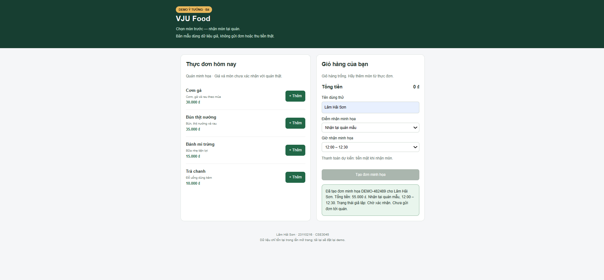

# B4 — Demo ý tưởng MVP

## Nội dung
Bản mẫu website đặt đồ ăn cho sinh viên VJU, dùng dữ liệu giả.
Người thực hiện: Lâm Hải Sơn — MSSV 23110216.

## Cách mở
Từ thư mục gốc repo, chạy trên Windows PowerShell:

    Start-Process .\demo\index.html

Hoặc mở trực tiếp tệp demo/index.html bằng trình duyệt.

## Kịch bản demo
1. Xem thực đơn và giá minh họa.
2. Thêm món vào giỏ.
3. Tăng hoặc giảm số lượng; quan sát tổng tiền.
4. Nhập tên dùng thử, chọn giờ nhận.
5. Bấm Tạo đơn minh họa.
6. Xem mã đơn, tổng tiền và trạng thái Chờ xác nhận.

## Kết quả chạy thử trên máy
Đã tạo được đơn minh họa với tổng tiền 55.000 VND,
điểm nhận tại quán mẫu, giờ nhận 12:00–12:30.
Sau khi tạo đơn, giỏ hàng được đặt lại về rỗng.

## Giới hạn
- Chỉ mô phỏng giao diện; chưa kết nối backend hoặc cơ sở dữ liệu.
- Không gửi đơn tới quán, không thu tiền thật.
- Tải lại trang sẽ đặt lại dữ liệu.
- Món, giá và điểm nhận chưa được xác nhận với quán thật.

## Phản hồi
Đã chạy thử trên máy cá nhân.
Chưa ghi nhận phản hồi demo từ giảng viên hoặc quán.
Sẽ cập nhật sau khi trình bày.

## Tài liệu liên quan
- [Phân vai và cách làm việc](06-scrum-team.md)
- [Backlog Sprint 0](07-sprint-0-backlog.md)
