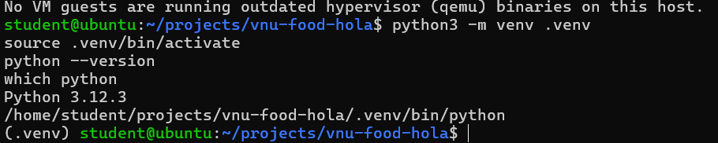
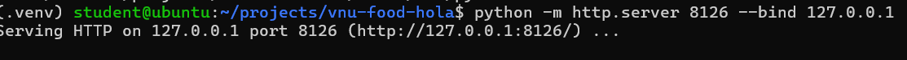
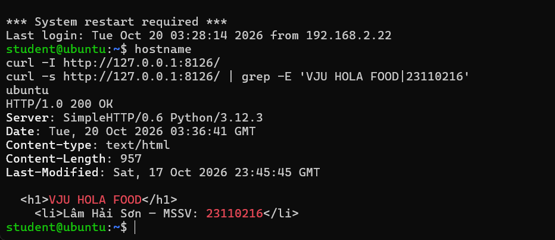

# B2 — Quy trình Git, rủi ro và minh chứng VPS

> Hồ sơ lịch sử bài thực hành B2, kiểm tra ngày **20/10/2026**. Không phản ánh trạng thái triển khai V7.3 hiện tại.

**Dự án:** Website đặt đồ ăn cho sinh viên VJU  
**Người thực hiện:** Lâm Hải Sơn — MSSV 23110216.

## Phân công và quy trình Git

Dự án do một sinh viên thực hiện, phụ trách tài liệu, giao diện, backend, kiểm thử và triển khai.

- `main`: phiên bản ổn định.
- `develop`: nhánh tích hợp các thay đổi.
- `feature/*`: nhánh thực hiện từng công việc.
- Quy trình dự kiến của giai đoạn B2: tạo nhánh từ `develop` → sửa và kiểm tra → commit → push → mở Pull Request vào `develop` → rà soát → merge.
- Mỗi PR trình bày thay đổi, lý do, cách kiểm tra và phần có AI hỗ trợ.
- Dự án cá nhân: tự kiểm tra hoặc AI hỗ trợ **không được ghi thành review độc lập** của người khác.

Quy ước Git đầy đủ: [GIT.md](GIT.md). Các nhánh/phát hành về sau có thể khác giai đoạn B2.

## Pre-mortem: Vì sao đồ án có thể thất bại?

Giả định cuối kỳ sản phẩm không đạt yêu cầu, các nguy cơ dự kiến tại thời điểm B2:

| STT | Nguy cơ thất bại | Nhóm nguyên nhân CHAOS | Hành động phòng ngừa |
|---|---|---|---|
| 1 | Chưa hiểu sinh viên cần gì khi đặt đồ ăn | Yêu cầu | Hỏi thử sinh viên mục tiêu, ghi lại nhu cầu và tiêu chí chấp nhận trước khi làm tính năng. |
| 2 | Liên tục thêm thanh toán, giao hàng, khuyến mãi khiến phạm vi quá lớn | Yêu cầu | Chốt phạm vi MVP; đưa ý tưởng mới vào danh sách chờ và chỉ thêm khi việc cốt lõi đã chạy. |
| 3 | Làm xong mới cho người dùng xem, phát hiện luồng đặt món khó dùng | Con người/bên liên quan | Cho người dùng thử từng luồng nhỏ và ghi nhận phản hồi sớm. |
| 4 | Một người phải làm mọi phần, bị quá tải khi trùng lịch học | Quản lý/nguồn lực | Chia công việc thành nhiệm vụ nhỏ, ưu tiên chức năng bắt buộc và dành thời gian dự phòng. |
| 5 | Ước lượng thiếu thời gian kiểm thử và triển khai | Quản lý/nguồn lực | Tính cả thời gian sửa lỗi, kiểm thử và deploy; chỉ đánh dấu hoàn thành khi có kết quả kiểm tra. |
| 6 | Hết block VPS hoặc lỗi môi trường sát hạn nộp | Quản lý/nguồn lực | Đặt block sớm, lưu mã trên GitHub, ghi lại lệnh chạy và kiểm tra triển khai trước hạn. |

Bảng quản lý rủi ro chi tiết được cập nhật riêng tại [RISKS.md](RISKS.md).

## Kết quả thực hành B2 — 20/10/2026

- Đã tạo và kích hoạt môi trường `.venv`, Python 3.12.3.
- Chạy thử bằng `python -m http.server 8126 --bind 127.0.0.1`.
- Kiểm tra trên VPS: HTTP 200 OK, nội dung đúng tên đồ án VJU HOLA FOOD và MSSV 23110216.
- Hostname thời điểm đó: `ubuntu`; IP nội bộ VPS: `192.168.2.211`.
- Đây là dịch vụ **chạy thử trong VPS**, không phải xác nhận URL công khai hay hosting bản V7.3.

## Minh chứng B2

Các hình trên là minh chứng của bài B2. Để kiểm tra triển khai và bài giữa kỳ hiện tại, xem [MIDTERM.md](MIDTERM.md).
